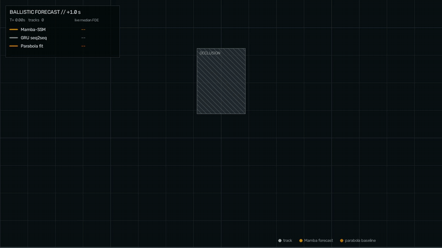
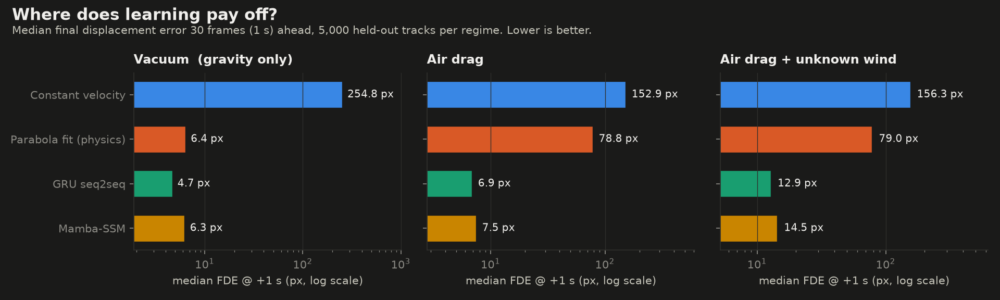
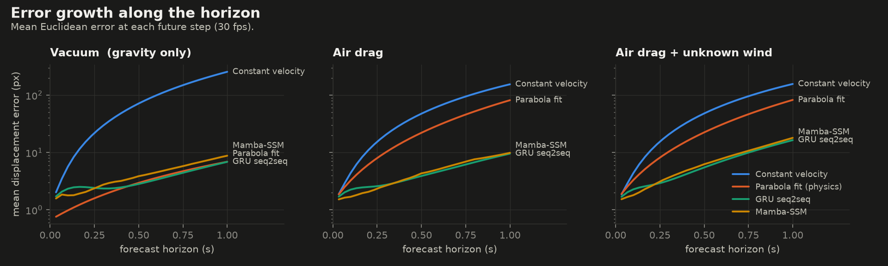
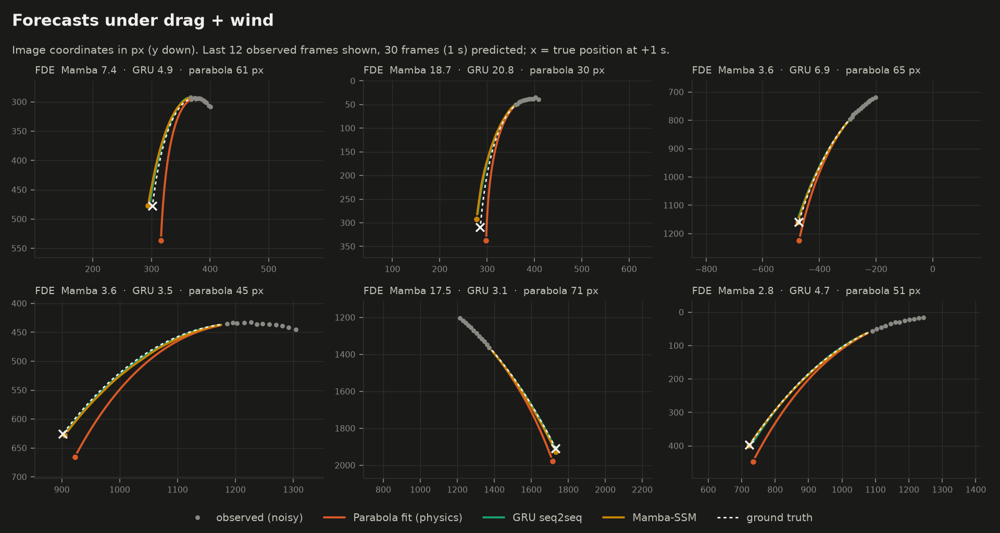
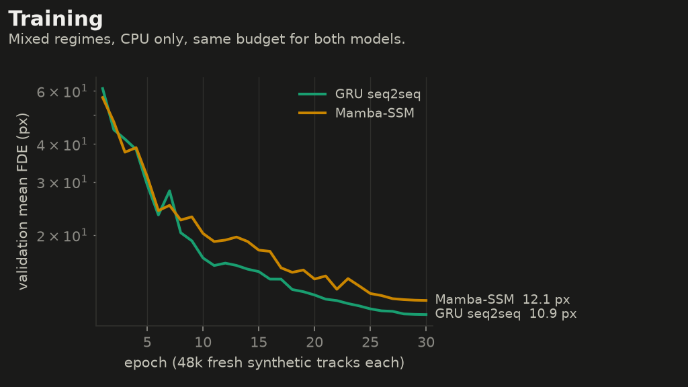
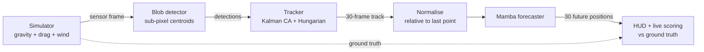

<div align="center">

# Ballistic Trajectory Forecasting

[](https://github.com/RaphaelKha/ballistic-trajectory-forecasting/actions/workflows/tests.yml)


[](LICENSE)

**Detect, track and forecast many flying objects 1 second ahead, in real time.**
Two forecasting models **designed and built from scratch** (a GRU seq2seq and a selective state-space / Mamba
model), running behind a Kalman + Hungarian multi-target tracker and benchmarked against physics baselines.



<sub>Every amber curve is a live Mamba forecast of where the projectile will be in 1 s; the dashed orange curve is a textbook parabola fit. The HUD scores every forecast against the simulator's ground truth, live.</sub>

</div>

---

## TL;DR

| | |
|---|---|
| **Task** | Given 1 s (30 frames) of noisy detections of a projectile, predict its next 1 s. |
| **Hard part** | Air drag and an unknown wind make flights non-parabolic, so the textbook physics fit breaks down. |
| **Result** | Under air drag and wind, both learned models cut the 1-second error of the physics fit **5 to 11×** (median FDE 79 px → 7–15 px). In vacuum, where the parabola is the exact model, they match it. |
| **Applications** | Ball flight in sports analytics, robots that catch or throw, drone and bird tracking, any "where will it be in a second?" problem. |
| **Stack** | PyTorch, NumPy, SciPy (Hungarian), OpenCV, matplotlib. Runs on a laptop CPU. |

## Results

| Model | Params | vacuum FDE (median / mean) | drag FDE (median / mean) | drag_wind FDE (median / mean) |
|---|---:|---:|---:|---:|
| Constant velocity | 0 | 254.8 / 254.7 px | 152.9 / 154.4 px | 156.3 / 156.3 px |
| Parabola fit (physics) | 0 | 6.4 / 6.9 px | 78.8 / 81.5 px | 79.0 / 82.4 px |
| GRU seq2seq | 397k | **4.7 / 6.9 px** | **6.9 / 9.5 px** | **12.9 / 16.4 px** |
| Mamba-SSM | 133k | 6.3 / 8.8 px | 7.5 / 9.9 px | 14.5 / 18.0 px |

<sub>Final Displacement Error (FDE) 30 frames ahead, on 5,000 held-out tracks per regime (test seed disjoint from training and validation). **Bold** = best in that column. Lower is better.</sub>



**Reading the results**

- **Vacuum is the control experiment.** Here the parabola *is* the true model, so beating it is not the goal. Both
  networks match it at +1 s (the GRU's median is even lower, 4.7 vs 6.4 px, because it has learned a prior on
  realistic gravity and speeds that makes it less sensitive to noise). At short horizons the parabola stays best,
  as expected (see the curves below).
- **With drag, the physics fit breaks down.** Its error grows to ~79 px at +1 s, while the GRU (6.9 px) and the
  Mamba model (7.5 px) stay about **11× more accurate**. They have to infer how strongly each object is slowed
  down from 30 noisy points.
- **Drag + unknown wind is the hardest case** (12.9 / 14.5 px). The wind is never observed directly; it can only
  be read off the curvature of the track.
- **GRU vs Mamba, honestly.** At the same training budget (30 epochs × 48k tracks) the GRU is slightly ahead on
  every regime. The Mamba model gets close with **3× fewer parameters** (133k vs 397k), and its validation curve was
  still going down at the last epoch. On CPU it is also about 2× slower per epoch, because the selective scan is a
  Python loop here, where the official implementation uses a fused CUDA kernel.
- **In the live demo** (tracker in the loop, 14 crossing shots, one occlusion band, 541 scored forecasts) the median
  error at +1 s is 17.1 px for the GRU, 19.1 px for Mamba and 74.9 px for the parabola. The tracker created 15
  identities for 14 shots (a single identity split).





### Ablation: what the output head changes

| Variant | Params | vacuum FDE median | drag FDE median | drag_wind FDE median |
|---|---:|---:|---:|---:|
| GRU, per-step displacement output (original design) | 397k | 4.5 px | 6.6 px | 12.6 px |
| Mamba, per-step displacement output | 133k | 8.6 px | 9.0 px | 15.1 px |
| Mamba, displacement output + larger Δ init + context queries | 133k | 17.1 px | 13.5 px | 20.3 px |
| GRU, acceleration output (final) | 397k | 4.7 px | 6.9 px | 12.9 px |
| Mamba, acceleration output (final) | 133k | 6.3 px | 7.5 px | 14.5 px |

<sub>Median FDE at +1 s on the same test sets.</sub>

- **Predicting accelerations instead of displacements** improves the Mamba model by 27 % in vacuum and 17 % under
  drag. For the GRU the +1 s error barely moves, but the error on the **first predicted frame drops from ~15 px to
  1.7 px**: the original decoder started each forecast with a visible jump. Both models' trajectories also become
  smooth, which is very visible in the demo video.
- **Feeding the current state into the future queries** (with a larger initial Δ) made things worse, so it was
  dropped. It is kept in `checkpoints/ablations/` for reproducibility.



## How it works



**1. Physics simulator** ([`physics.py`](src/ballistic_forecast/physics.py)). It integrates
`a = g − k·|v − w|·(v − w)` (gravity, quadratic air drag towards a horizontal wind) for thousands of shots at
once. Three regimes: **vacuum** (a pure parabola), **drag**, and **drag + wind**. Detections are pixel-quantised
and jittered (σ = 1 px) like a real sensor. The targets are the *true* positions.

**2. Detection and tracking** ([`tracking/`](src/ballistic_forecast/tracking)). A threshold-and-connected-components
detector stands in for YOLO. Each track runs a constant-acceleration Kalman filter. Detections are assigned to
tracks by the Hungarian algorithm on the predicted positions, with a distance gate. Unmatched tracks *coast* on
their Kalman prediction, which is how identities survive crossings and the occlusion band in the demo.

**3. Our forecaster** ([`models/mamba.py`](src/ballistic_forecast/models/mamba.py)). We designed the
forecasting architecture ourselves and built every part of it, including the Mamba backbone:

```
[ obs₁ … obs₃₀ | q₁ … q₃₀ ]  →  4 × Mamba block  →  head(q₁…q₃₀) → accelerations
                                                         → ∫ velocity → ∫ position (closed form)
```

- **Future-query tokens, non-autoregressive decoding.** Thirty learned `qₕ` tokens are appended after the
  observations. The causal scan carries the state built from the track into them, and all 30 future steps are
  predicted in one pass, with no error feedback loop.
- **Physics-informed head.** Each query predicts an *acceleration*. Velocity and position are integrated in
  closed form from the measured state, so a forecast starts exactly where the object is and cannot jitter.
- **Backbone.** This is our own pure-PyTorch implementation of the S6 selective scan from
  [Gu & Dao, 2023](https://arxiv.org/abs/2312.00752): input-dependent Δ, B and C, ZOH discretisation, a causal
  depthwise conv and SiLU gating. The official `mamba_ssm` package requires CUDA; this one runs on any laptop.

**4. Baselines.** A *parabola fit* (least-squares quadratic in t) is the exact model of drag-free flight, so it is
the bar to beat in vacuum. *Constant velocity* is the naive floor. **GRU seq2seq**, our first model, is designed and built
by the author: an encoder GRU reads the track, an autoregressive decoder rolls the future out step by step, inputs
are re-centred on the last observed point, and a horizon-weighted loss puts extra weight on the final point. In this
version it also gets the physics-informed acceleration head.

**Design choices that mattered**
- **Relative coordinates.** Inputs are re-centred on the last observed point, which makes the model
  translation-invariant. There is a test for it.
- **Fresh data every epoch.** The simulator is cheap, so the models never see the same window twice and cannot
  overfit.
- **Physics-informed output.** The networks predict *accelerations*; velocity and position are integrated in
  closed form from the measured state. Forecasts start exactly where the object is and are smooth by
  construction (see the ablation below).
- **Horizon-weighted loss.** Far-future steps and the final point weigh more, because the end of the horizon is
  where a forecast is both hardest and most useful.
- **Honest scoring.** Every forecast is scored against the simulator's ground truth (not against the tracker),
  including shots that leave the screen. Both the median and the mean are reported.

## What we built vs. what we reused

| Designed and built for this project | Reused from the literature |
|---|---|
| Forecaster architecture: future-query tokens, one-pass decoding, acceleration head with closed-form integration | The S6 selective-scan equations (Gu & Dao, 2023), reimplemented from scratch |
| GRU seq2seq forecaster: encoder + autoregressive decoder, relative-coordinate inputs, horizon-weighted loss | The GRU cell itself (PyTorch `nn.GRU`) |
| Pure-PyTorch Mamba block that runs on CPU, with a fast causal conv and an O(L) backward | |
| Physics simulator (gravity, quadratic drag, wind) and the benchmark protocol | Kalman filter and Hungarian algorithm (textbook; SciPy for the assignment) |
| Tracker, live HUD, ground-truth scoring, figures, tests | |

## Quickstart

```bash
git clone https://github.com/RaphaelKha/ballistic-trajectory-forecasting && cd ballistic-trajectory-forecasting
uv venv --python 3.11 && uv pip install -e ".[dev]"

.venv/bin/ballistic demo --gif assets/demo.gif        # uses the checkpoints shipped in checkpoints/
.venv/bin/ballistic benchmark                         # results/benchmark.{json,md}
.venv/bin/ballistic figures                           # assets/*.png

.venv/bin/ballistic train --config configs/mamba.yaml # retrain from scratch (CPU)
.venv/bin/pytest                                      # unit tests
```

## Repository map

```
src/ballistic_forecast/
  physics.py        simulator: gravity, quadratic drag, wind
  data.py           windows + relative-coordinate normalisation
  models/           mamba.py · gru.py · baselines.py
  tracking/         detector · Kalman CA filter · Hungarian tracker
  train.py          training loop        benchmark.py   per-regime evaluation
  scene.py · demo.py · viz/              live HUD video and README figures
configs/            one YAML per trained model
checkpoints/        trained weights + training curves
tests/              physics, causality, translation invariance, tracking through crossings and occlusion
```

## The story (and what went wrong first)

This project started from a question: if [Video Mamba](https://arxiv.org/abs/2403.06977)-style state-space
models can predict how a video continues, can one predict *where a flying object will be* a second from now?
It took three iterations.

**v1: learn from pixels.** A CNN regressed target positions directly from 128×128 frames. It plateaued at about
10 px of error on a 128 px image (8 % of the frame). In hindsight, despite its name the model had no temporal
layer at all: every frame was processed independently, so it could not use motion. Pixels were also a
needlessly hard input when a detector already provides coordinates.

**v2: learn from coordinates.** A seq2seq GRU on 30-frame tracks, behind a nearest-neighbour tracker. It worked,
but on drag-free parabolas, where a 3-coefficient polynomial fit is already near-optimal, so the network was
solving a problem that did not need one. Errors were also measured against the tracker's own output, and the
plotted error range was trimmed.

**v3: this repository.** It adds a simulator with drag and wind (where physics fits genuinely fail), the
parabola baseline as the bar to beat, a real from-scratch Mamba, a Kalman + Hungarian tracker, the
acceleration-output decoder, scoring against ground truth, tests, and one-command reproducibility on a laptop.

Lessons I would apply to any forecasting problem:
1. **Beat the physics baseline first.** If a closed-form model already solves the problem, a network is overhead.
2. **Decode in the space where the prior lives.** Predicting accelerations instead of positions cut the error
   and removed the jitter (see the ablation).
3. **Score against the truth, report the distribution.** Medians, means and tails, with no trimmed axes.

## Limitations and next steps

- Synthetic data only. The next step is real footage (e.g. sports ball tracking) with a learned detector.
- 2D image-plane motion with a fixed frame rate. Variable dt and 3D would need a time-aware model.
- A physics model that *knows* the drag equation (fitting k and w by nonlinear least squares) would be a
  stronger, oracle-style baseline. The point here is learning the dynamics without being told the equations.
- Single deterministic forecast. A probabilistic head (mixture or quantiles) would expose uncertainty, which
  matters to any downstream planner (e.g. a robot arm catching a ball).

<sub>Built with Claude Code. See [`CLAUDE.md`](CLAUDE.md) for the conventions used to keep the repo agent-friendly.</sub>

## License

MIT, see [LICENSE](LICENSE).
